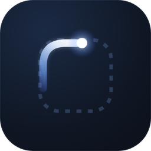
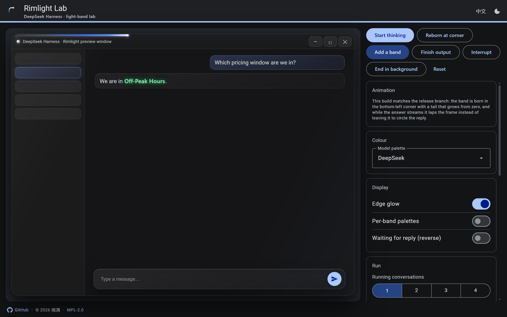
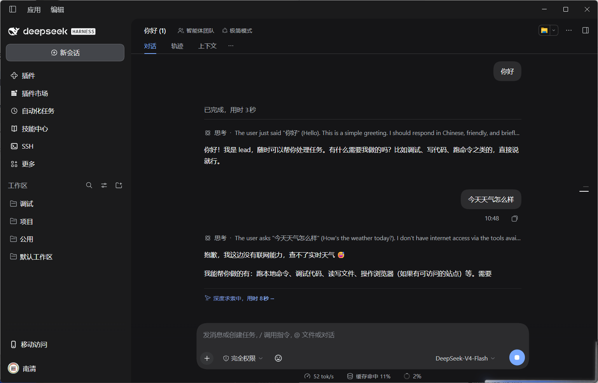
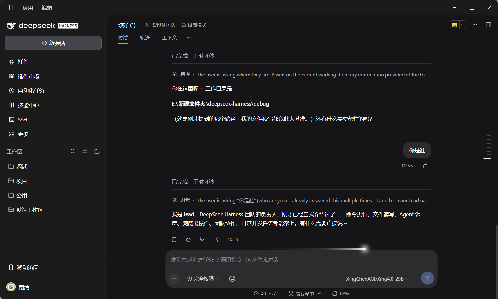
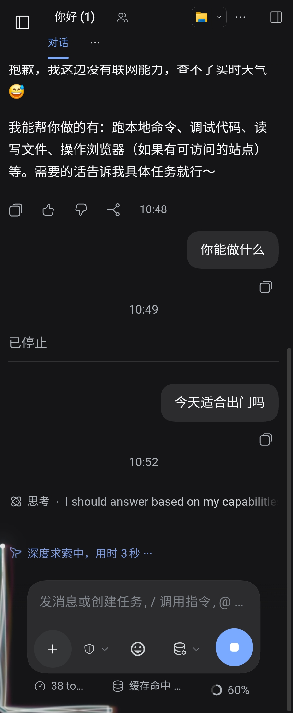
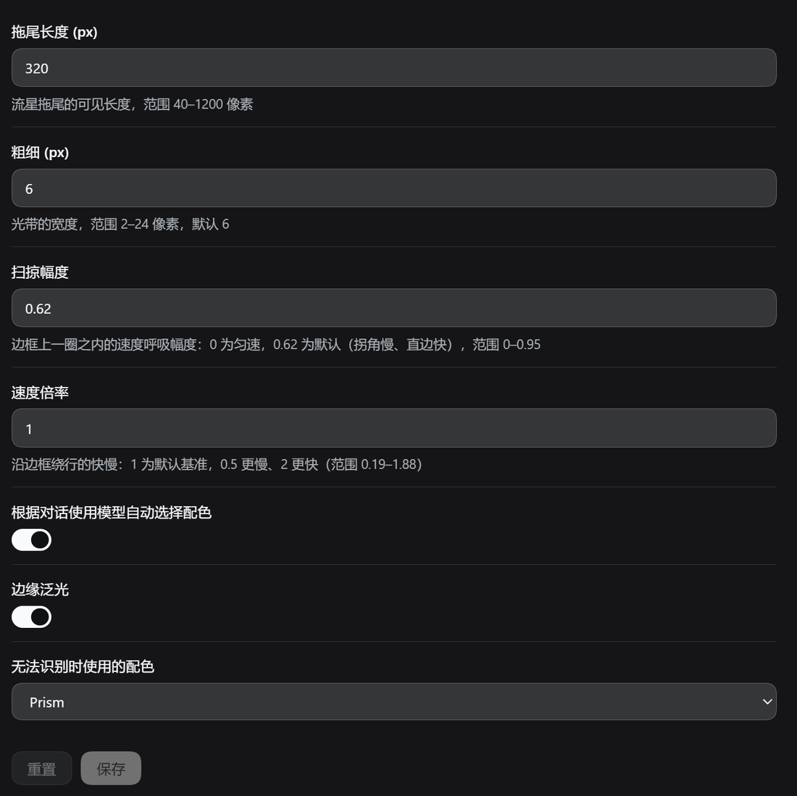
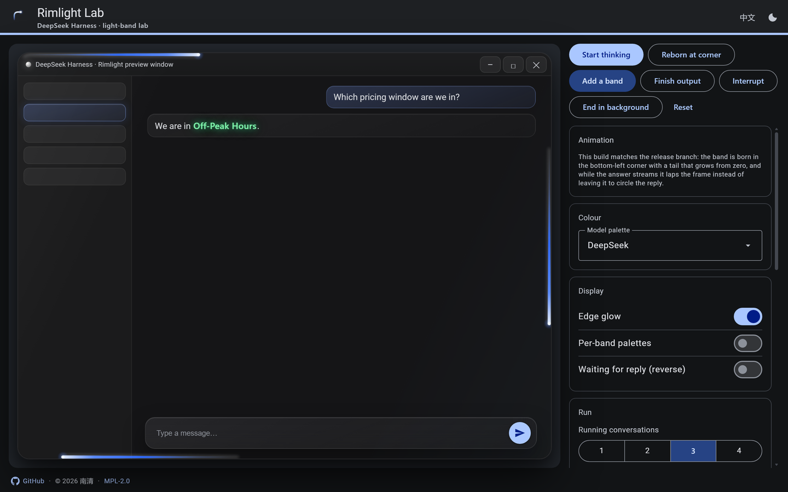
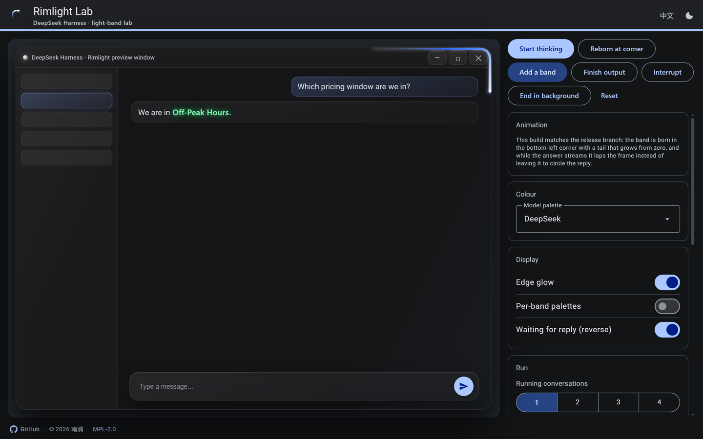

<h1 align="center">Rimlight</h1>

<p align="center"></p>

<p align="center">A lightweight cosmetic plugin that gives DeepSeek Harness a comet-like light band flowing non-linearly along the window edge while a turn is thinking.</p>

<p align="center">
  <a href="https://polang233.github.io/dsh-plugin-index/zh/plugins/dsh-rimlight/"></a>
  <a href="https://awesome-dsh-plugin.com"></a>
  <a href="https://dsh-plugin.org/plugins/nanqing233/dsh-rimlight"></a>
  <a href="https://www.npmjs.com/package/dsh-rimlight"></a>
  <a href="LICENSE"></a>
</p>

<p align="center">
  <a href="README.md">简体中文</a> ·
  <strong>English</strong>
</p>

<p align="center">
  <a href="https://xn--de-gj5f71e.luxe">Live preview</a> ·
  <a href="#install">Install</a> ·
  <a href="#settings">Settings</a>
</p>

## Preview



### In the real client

|  |  |
| --- | --- |
| Follows the window corner | Returns to the composer when the turn ends |

<p align="center"><br><sub>Scales to mobile proportions</sub></p>

<p align="center"><br><sub>Plugin settings page (v1.1.0, Simplified Chinese)</sub></p>

## How it works

While a conversation is thinking, a comet-like band appears on the rounded border of the client window and circles it non-linearly. Every conversation that is thinking at the same time owns one band, up to four, coloured by the model that conversation uses and spaced evenly around the same lap. When a conversation ends, its band flies to the matching place on screen, laps it once, and fades out.

## Features

| Behaviour | Description |
| --- | --- |
| **Flows while thinking** | While a turn runs, the band moves clockwise and non-linearly along the rounded border: the head is brightest, the tail drags a gradient behind it, and the band bends with the track as it passes a corner. |
| **Several sessions at once** | Up to four bands, one per session. When a new band joins, all of them adjust speed together and settle on evenly spaced positions within four seconds. |
| **Reversed while waiting** | A conversation waiting for your input turns the loop counter-clockwise; it goes back to clockwise once you reply, and the direction change is eased. |
| **Colour per model** | Each band takes its colour from the model its conversation uses. Thirteen palettes ship (see below), and a fixed global palette can be chosen in the settings. |
| **Edge glow** | A white highlight and a soft halo are layered on both sides of the band. |
| **Light window adaptation** | On a bright client surface the band lightens its body and hands the contrast to a dark outline (about 3:1), so it keeps an edge on white; the dark surface is untouched. |
| **Return flight** | When a conversation ends, its band flies to the matching target, laps it once, and fades out: the current conversation → the composer; a background conversation → its row in the sidebar; that row off screen → the workspace; sidebar collapsed → the expand button. |
| **Rendering isolation** | Drawn on its own overlay: no host code is modified and no pointer events are taken. DOM and geometry access are wrapped in guards, so a failure inside the plugin cannot break the client's rendering. The overlay carries `contain: layout paint style`, so repainting a band cannot invalidate the app underneath. |

| Evenly spaced bands | Reversed while waiting |
| --- | --- |
|  |  |

## Palettes

The gradient runs tail → head. The table lists the solid stops (the tail starts and ends at the same colour with zero alpha, so the first opaque stop is the one shown):

| key | Name | Gradient (tail → head) | Notes |
| --- | --- | --- | --- |
| `deepseek` | DeepSeek | `#2f6bff` → `#5b8dff` → `#eaf2ff` | — |
| `kimi` | Kimi | `#8f97a8` → `#e6eaf2` → `#ffffff` | Sparks floating in the tail |
| `openai` | OpenAI | `#6f9b8b` → `#cfe6dd` → `#f4fffa` | — |
| `claude` | Claude | `#e07a4f` → `#b64f28` → `#ffeada` | — |
| `zhipu` | GLM | `#7285ab` → `#bccce8` → `#f4f8ff` | — |
| `gemini` | Gemini | `#34a853` → `#fbbc05` → `#ea4335` → `#ffffff` | Google's four colours |
| `qwen` | Qwen | `#1d3fd6` → `#3f6bff` → `#dbe6ff` | — |
| `grok` | Grok | `#141518` → `#c9ccd4` → `#ffffff` | Black → white |
| `minimax` | MiniMax | `#ff5fc0` → `#ff2d63` → `#ffdcec` | — |
| `mimo` | MiMo | `#f6edc8` → `#fcf7e6` → `#fffefa` | — |
| `meta` | Meta | `#2f7bff` → `#0866ff` → `#e2eeff` | — |
| `nvidia` | NVIDIA | `#76b900` → `#a4e01f` → `#f4ffd9` | — |
| `unknown` | Prism | Layered translucent whites | Dispersion, edge deformation |

Model detection uses the model id and name first, and the provider only as a fallback. When nothing matches, **Prism** is used; another palette can be chosen in the settings.

## Install

**Compatibility**: works in both `web` and `desktop`.

### Option 1: from the Plugins page (recommended)

1. Get this directory (`dsh-rimlight`).
2. Open the Plugins page, choose to install a local plugin, and point it at this directory.
3. On success it reports `application: applied` and the plugin is live; if the UI has not updated, restart the client once.

### Option 2: from the command line

```bash
# Link the plugin directory into a profile (desktop is the example, use your own)
dsh plugin --profile desktop add "link:/absolute/path/dsh-rimlight"
```

The `link:` prefix links the local directory directly instead of pulling from a registry. The client writes the package into the profile's `dependencies` and merges the package's declared `dsh.bundle.patch` into `dsh.profile.bundles`; the plugin is live after a restart.

### Option 3: from npm

```bash
dsh plugin --profile desktop add dsh-rimlight
```

### Option 4: from GitHub

```bash
dsh plugin --profile desktop add "https://github.com/NanQing233/dsh-rimlight"
```

### Uninstall

```bash
dsh plugin --profile desktop remove dsh-rimlight
```

## Settings

Found under Plugins → Rimlight → Settings.

| Setting | Default | Range | Description |
| --- | --- | --- | --- |
| Trail length `trailLength` | 320 | 40–1200 | Visible length of the tail (px) |
| Thickness `thickness` | 6 | 2–24 | Width of the band (px) |
| Speed multiplier `speed` | 1 | 0.19–1.88 | How fast the band circles the frame, quoted against the default pace as `1.0` |
| Sweep amplitude `sweep` | 0.62 | 0–0.95 | Speed breathing within one lap: `0` is constant speed; larger values slow the band down in corners and speed it up on straight edges. Changes ease in over 200 ms |
| Edge glow `edgeGlow` | On | — | The highlight and halo on both sides of the band |
| Auto colour by conversation model `modelColor` | On | — | When off, the global palette is used |
| Global palette `theme` | — | 13 palettes | Shown only when auto colouring is off |
| Palette for unknown models `unknownTheme` | Prism | 13 palettes | Used when the model name cannot be recognised |

## Lab

`lab/rimlight-lab.html` and `lab/rimlight-lab.js` form a standalone interactive lab: it loads this plugin's `client.js` directly and reuses the same track geometry and animation code, renders the effect over a replica of the client window, and lets you change parameters, switch palettes, and simulate several sessions, waiting for a reply, finishing the output and interrupting by hand.

The preview in this README is captured from it. The lab speaks Chinese and English; the switch is in the top-right corner, next to the light/dark toggle.

Run it locally from the repository root:

```bash
python -m http.server 8733 --bind 127.0.0.1
# then open http://127.0.0.1:8733/lab/rimlight-lab.html
```

Common URL parameters:

| Parameter | Description |
| --- | --- |
| `mode=thinking` \| `streaming` \| `done` \| `stop` | Initial state |
| `n=1..4` | Number of concurrent bands |
| `trail=320` / `t=6` | Trail length / thickness |
| `theme=kimi` | Force a palette (`theme=prism` is the same as `unknown`) |
| `speed=1.2` | Speed multiplier (default 1, range 0.19–1.88) |
| `surface=light` \| `dark` | Force the window surface |
| `lang=zh` \| `en` | UI language |
| `scheme=fidelity` \| `content` \| `tonal-spot` | Accent derivation variant (default `fidelity`) |
| `layout=mobile` \| `desktop` | Force the layout |
| `multi=1` | One palette per band |
| `reply=1` | Waiting for a reply (reverse flow) |
| `sweep=0` | Sweep amplitude (`0` is constant speed) |
| `p=0.45` | Pin the band to one phase of the lap (0–1); with `motion=off` the same frame can be reproduced |
| `warm=1600` | Pre-run N milliseconds |
| `click=reset,think&after=900` | Press panel buttons in order, then pre-run |
| `motion=off` | Disable transitions and animations (virtual time does not advance transitions, so a shot can keep the previous theme's colours) |

## Project layout

```
dsh-rimlight/
├── client.js          # Client half: overlay rendering, track geometry, animation, settings panel, both languages
├── index.js           # Host half: config schema (schemastery)
├── cordis.patch.yml   # bundle patch: inserts the plugin into a profile
├── package.json
├── icon.svg
├── locale/
│   ├── zh.json
│   └── en.json
├── lab/               # Standalone lab
│   ├── rimlight-lab.html
│   └── rimlight-lab.js
├── docs/              # Images used by the READMEs
├── screenshots.json   # Screenshot list for the plugin market page
└── LICENSE
```

## Compatibility

- Runs in the DSH client rendering layer; once installed into a profile it loads with the client.
- The native caption button strip at the top-right of the desktop window would paint over the drawing, so the plugin cuts that area out with a feathered ramp.
- Depends on the public modules the host provides (`react`, `@deepseek-ai/dsh-client-ui-*`, `@deepseek-ai/schemastery`).
- The band is drawn on its own overlay: it takes part in no layout and receives no pointer events.
- Detecting "final output" relies on the host's DOM structure. If a host upgrade changes the internal class names that detection can stop working, and the plugin falls back to always running along the border; client stability is unaffected.

## License

[Mozilla Public License 2.0](LICENSE) (MPL-2.0).

---

<p align="center">
  <a href="https://github.com/deepseek-ai/deepseek-harness"></a>
</p>
