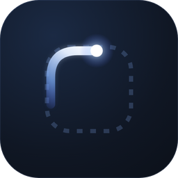
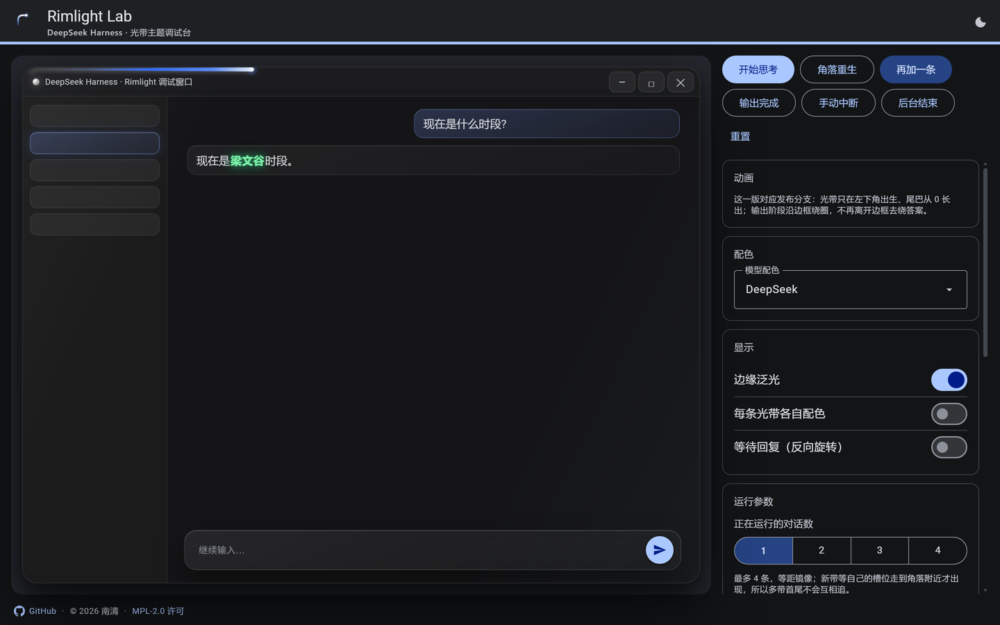
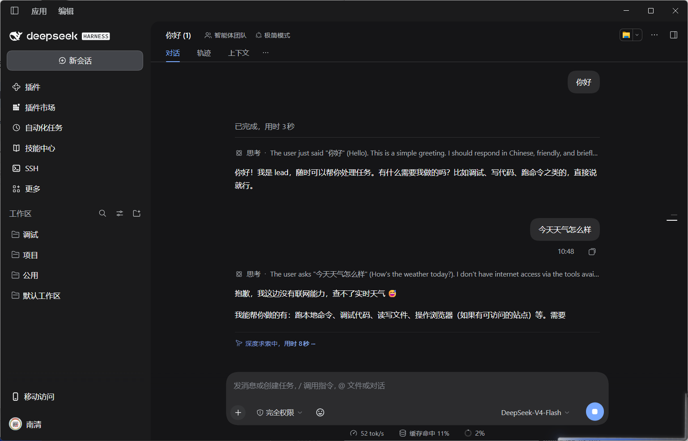
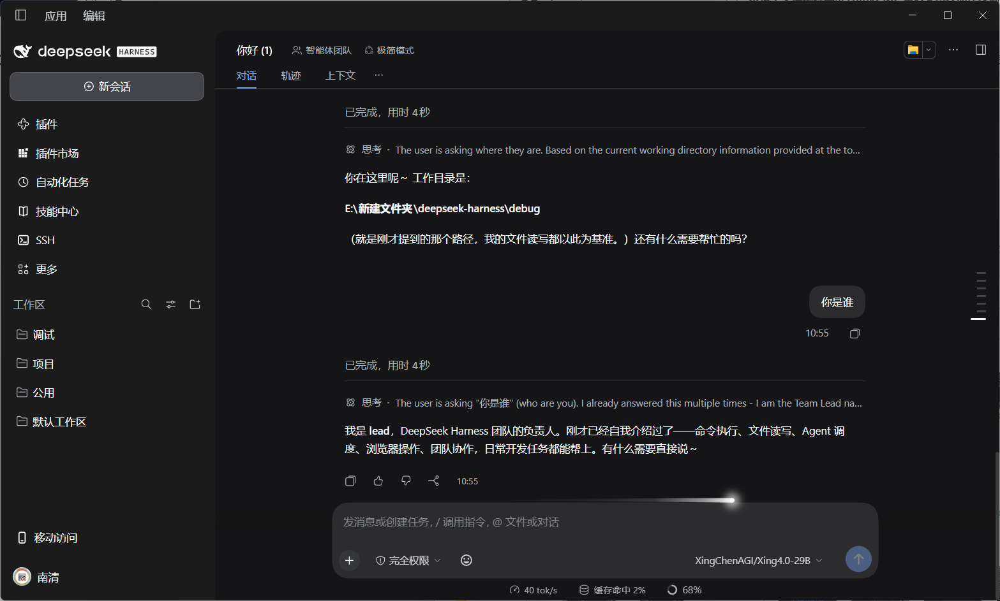
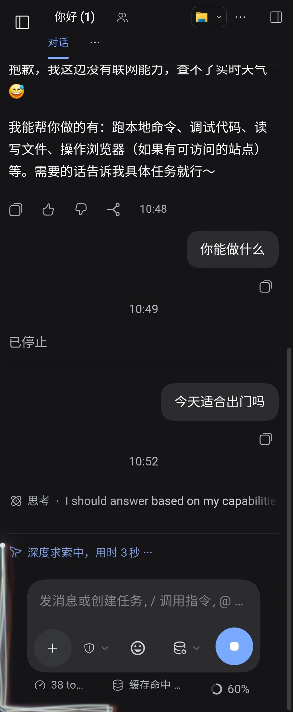
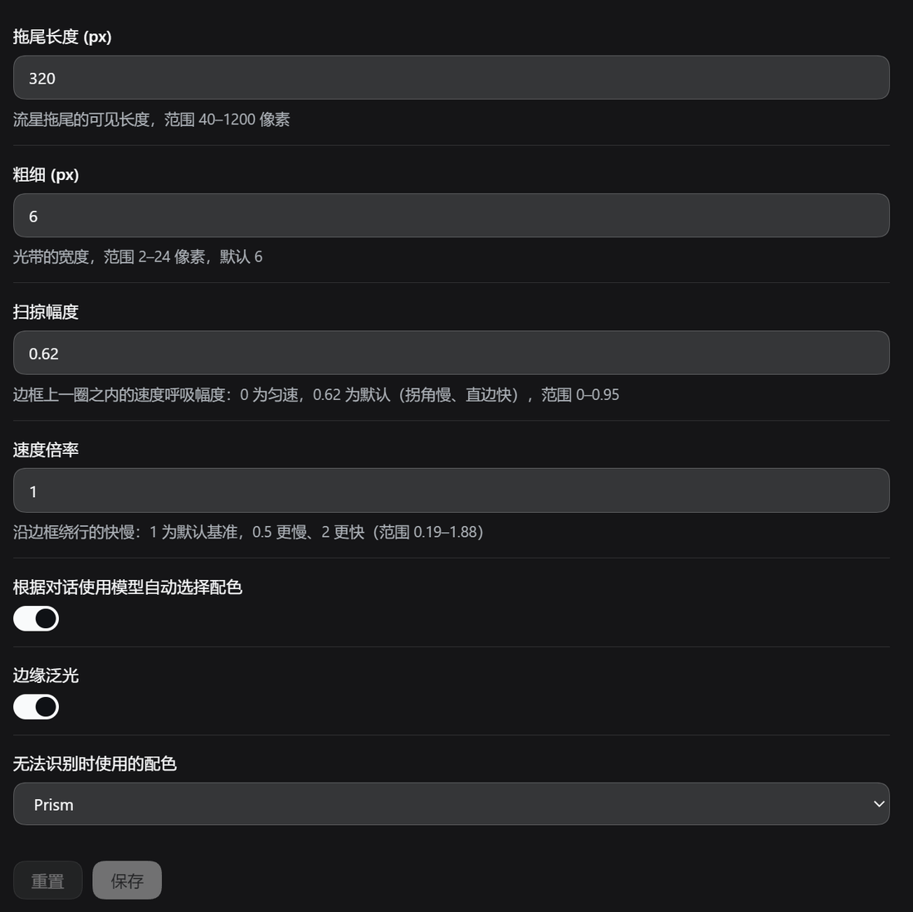
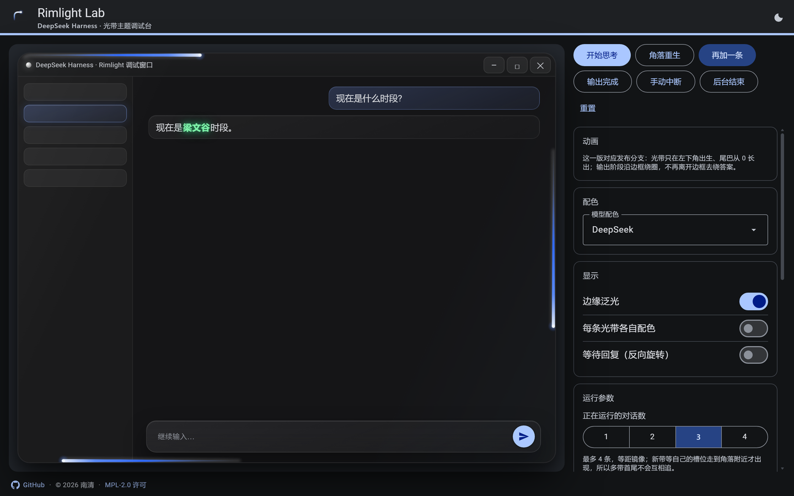
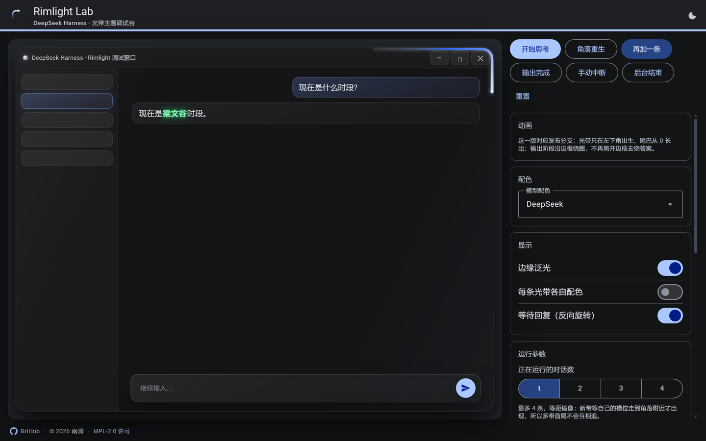

<h1 align="center">Rimlight</h1>

<p align="center"></p>

<p align="center">为 DeepSeek Harness 提供「思考时沿窗口边缘非线性流动的流星光带」的轻量美化插件。</p>

<p align="center">
  <a href="https://polang233.github.io/dsh-plugin-index/zh/plugins/dsh-rimlight/"></a>
  <a href="https://awesome-dsh-plugin.com"></a>
  <a href="https://dsh-plugin.org/plugins/nanqing233/dsh-rimlight"></a>
  <a href="https://www.npmjs.com/package/dsh-rimlight"></a>
  <a href="LICENSE"></a>
</p>

<p align="center">
  <strong>简体中文</strong> ·
  <a href="README.en.md">English</a>
</p>

<p align="center">
  <a href="https://xn--de-gj5f71e.luxe">预览效果</a> ·
  <a href="#安装">安装</a> ·
  <a href="#设置">设置</a>
</p>

## 效果




### 实际运行效果

|  |  |
| --- | --- |
| 适配窗口圆角 | 对话结束后返回对话框 |

<p align="center"><br><sub>适配移动设备比例</sub></p>

<p align="center"><br><sub>插件设置页面（V1.1.0，简体中文）</sub></p>

## 工作方式

会话进入思考状态后，客户端窗口的圆角边框上会出现一条流星式光带，沿边框非线性环绕运行。同时处于思考状态的会话各自拥有一条光带，最多 4 条，按所属会话使用的模型取色，并在同一圈内等距分布。会话结束时，光带飞向与之对应的界面位置，绕行一圈后淡出。

## 特性

| 行为 | 说明 |
| --- | --- |
| **思考时流动** | 会话运行期间，光带沿窗口圆角边框顺时针非线性运动：头部最亮，尾部向后拖出渐变，经过圆角时随轨道弯折。 |
| **多会话并行** | 最多 4 条，每条对应一个会话。新光带加入后，所有光带在 4 秒内同步加减速，平滑收敛到等距位置。 |
| **等待回复反向** | 会话进入等待用户输入的状态时改为逆时针；用户回复后恢复顺时针，方向切换带缓动过渡。 |
| **按模型配色** | 每条光带按所属会话所用的模型取色，预设 13 套（见下表），可在插件设置中固定全局使用配色。 |
| **边缘泛光** | 在光带两侧叠加白色高光与柔光。 |
| **亮色窗口适配** | 明亮的客户端界面上，光带会把主体提亮、改用深色描边承担对比（约 3:1），使白底上的带子依然有轮廓；暗色界面不受影响。 |
| **结束回程** | 会话结束时，光带飞向对应目标并绕行一圈后淡出：当前对话 → 输入框；后台会话 → 侧边栏中对应行；该行不在可视区域 → 工作区；侧边栏折叠 → 展开按钮。 |
| **渲染隔离** | 绘制在独立覆盖层上，不修改宿主代码，不接收指针事件；DOM 与几何访问均有异常兜底，插件自身异常不会中断客户端渲染。覆盖层带 `contain: layout paint style`，光带重绘不会波及底下应用的布局与绘制。 |

| 多条光带等距分布 | 等待回复时反向 |
| --- | --- |
|  |  |

## 配色

渐变方向为尾部 → 头部，下表列出各 stop 的实色（尾部起止为同色低透明度，故从首个不透明 stop 起列）：

| key | 名称 | 渐变（尾 → 头） | 特征 |
| --- | --- | --- | --- |
| `deepseek` | DeepSeek | `#2f6bff` → `#5b8dff` → `#eaf2ff` | — |
| `kimi` | Kimi | `#8f97a8` → `#e6eaf2` → `#ffffff` | 尾部漂浮粒子 |
| `openai` | OpenAI | `#6f9b8b` → `#cfe6dd` → `#f4fffa` | — |
| `claude` | Claude | `#e07a4f` → `#b64f28` → `#ffeada` | — |
| `zhipu` | GLM | `#7285ab` → `#bccce8` → `#f4f8ff` | — |
| `gemini` | Gemini | `#34a853` → `#fbbc05` → `#ea4335` → `#ffffff` | Google 四色 |
| `qwen` | Qwen | `#1d3fd6` → `#3f6bff` → `#dbe6ff` | — |
| `grok` | Grok | `#141518` → `#c9ccd4` → `#ffffff` | 黑→白 |
| `minimax` | MiniMax | `#ff5fc0` → `#ff2d63` → `#ffdcec` | — |
| `mimo` | MiMo | `#f6edc8` → `#fcf7e6` → `#fffefa` | — |
| `meta` | Meta | `#2f7bff` → `#0866ff` → `#e2eeff` | — |
| `nvidia` | NVIDIA | `#76b900` → `#a4e01f` → `#f4ffd9` | — |
| `unknown` | Prism | 半透明白多层叠加 | 色散、边缘形变 |

模型识别以模型 id 与名称为主、供应商为辅；无法识别时使用 **Prism**，可在设置中改为其它配色。

## 安装

**兼容性**：``web``与``desktop``全兼容

### 方式一：插件页安装（推荐）

1. 获取本目录（`dsh-rimlight`）。
2. 打开「插件」页，选择安装本地插件，目标指向该目录。
3. 安装成功后返回 `application: applied`，插件立即生效；若界面未更新，重启一次客户端。

### 方式二：命令行安装


```bash
# 把插件目录链接进 profile（示例为 desktop，按实际 profile 名替换）
dsh plugin --profile desktop add "link:/绝对路径/dsh-rimlight"
```

`link:` 前缀表示直接链接本地目录，而不是从注册表拉取。命令执行后，客户端会把包写入 profile 的 `dependencies`，并按包内声明的 `dsh.bundle.patch` 自动并入 `dsh.profile.bundles`；重启客户端后插件生效。

### 方式三：从 npm 安装

```bash
dsh plugin --profile desktop add dsh-rimlight
```

### 方式四：从 GitHub 安装


```bash
dsh plugin --profile desktop add "https://github.com/NanQing233/dsh-rimlight"
```


### 卸载

```bash
dsh plugin --profile desktop remove dsh-rimlight
```


## 设置

位于「插件 → Rimlight → 设置」。

| 设置项 | 默认 | 范围 | 说明 |
| --- | --- | --- | --- |
| 拖尾长度 `trailLength` | 320 | 40–1200 | 尾部可见长度（px） |
| 粗细 `thickness` | 6 | 2–24 | 光带宽度（px） |
| 速度倍率 `speed` | 1 | 0.19–1.88 | 环绕一圈的快慢，以默认速率为基准 `1.0` |
| 扫掠幅度 `sweep` | 0.62 | 0–0.95 | 一圈内的速度呼吸：`0` 为匀速，取值越大则拐角越慢、直边越快；改动在 200 ms 内平滑生效 |
| 边缘泛光 `edgeGlow` | 开 | — | 光带两侧的高光与柔光|
| 根据对话使用模型自动选择配色 `modelColor` | 开 | — | 关闭后使用「全局配色」 |
| 全局配色 `theme` | — | 13 套 | 仅在关闭自动配色后显示 |
| 无法识别时使用的配色 `unknownTheme` | Prism | 13 套 | 模型名无法识别时使用 |

## 调试台

`lab/rimlight-lab.html` 与 `lab/rimlight-lab.js` 构成一个独立的交互式调试台：它直接加载本插件的 `client.js`，复用同一份轨道几何与动画代码，在复刻的客户端窗口中渲染效果，可实时调整参数、切换配色，并模拟多会话、等待回复、输出完成与手动中断等状态。

本地运行（自仓库根目录）：

```bash
python -m http.server 8733 --bind 127.0.0.1
# 浏览器访问 http://127.0.0.1:8733/lab/rimlight-lab.html
```

常用 URL 参数：

| 参数 | 说明 |
| --- | --- |
| `mode=thinking` \| `streaming` \| `done` \| `stop` | 初始状态 |
| `n=1..4` | 并发光带数 |
| `trail=320` / `t=6` | 拖尾长度 / 粗细 |
| `theme=kimi` | 强制指定配色（`theme=prism` 等同于 `unknown`） |
| `speed=1.2` | 速度倍率（默认 1，范围 0.19–1.88） |
| `surface=light` \| `dark` | 强制指定窗口表面明暗模式 |
| `lang=zh` \| `en` | 界面语言 |
| `scheme=fidelity` \| `content` \| `tonal-spot` | 派生变体（默认 fidelity） |
| `layout=mobile` \| `desktop` | 强制版式 |
| `multi=1` | 每条光带各自配色 |
| `reply=1` | 等待回复（反向流动） |
| `sweep=0` | 扫掠幅度（0 为匀速） |
| `p=0.45` | 把光带定格在轨道上的指定相位（0–1），配合 `motion=off` 可复现同一帧画面 |
| `warm=1600` | 预跑 N 毫秒 |
| `click=reset,think&after=900` | 依次点击面板按钮后再预跑 |
| `motion=off` | 关闭过渡与动画（虚拟时间不推进 transition，会截到上一个主题的颜色） |

## 项目结构

```
dsh-rimlight/
├── client.js          # 客户端半：覆盖层渲染、轨道几何、动画、设置面板、双语
├── index.js           # 宿主半：配置 schema（schemastery）
├── cordis.patch.yml   # bundle patch：将插件插入 profile
├── package.json
├── icon.svg
├── locale/
│   ├── zh.json
│   └── en.json
├── lab/               # 独立调试台
│   ├── rimlight-lab.html
│   └── rimlight-lab.js
├── docs/              # README 配图
├── screenshots.json   # 插件市场详情页截图清单
└── LICENSE
```

## 兼容性

- 运行在 DSH 的客户端渲染层，装进 profile 后随客户端加载。
- 桌面客户端右上角原生窗控条会遮住绘制内容，插件据此去掉该部分并留羽化。
- 依赖宿主提供的公开模块（`react`、`@deepseek-ai/dsh-client-ui-*`、`@deepseek-ai/schemastery`）。
- 光带绘制在独立覆盖层，不参与布局，不接收指针事件。
- 「最终输出」的判定依赖宿主界面的 DOM 结构；宿主版本升级后若内部类名变化，该判定可能失效，此时插件会回退为始终沿边框运行，不影响客户端稳定性。

## 许可证

[Mozilla Public License 2.0](LICENSE)（MPL-2.0）。

---

<p align="center">
  <a href="https://github.com/deepseek-ai/deepseek-harness"></a>
</p>